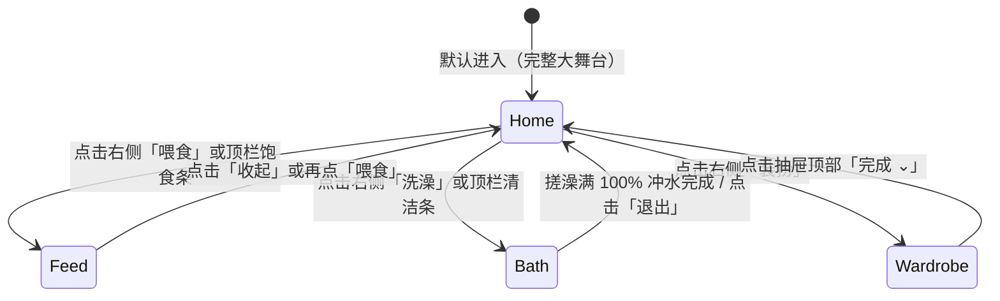

# PRD-0001：蛋宝宝轻陪伴电子宠物（喂食 / 洗澡 / 情绪小反应）

## 1. 文档元信息

| 项目 | 说明 |
| :--- | :--- |
| **文档编号** | `PRD-0001` |
| **版本与状态** | `v1.0`（已开发上线） |
| **适用平台** | H5（GitHub Pages）、原生微信小程序（Uni-app 一码双端），预留抖音小程序 |
| **在线体验入口** | 主入口：`https://octopusgump.github.io/eggbabe-h5/`<br>脏污臭气预览直链：`https://octopusgump.github.io/eggbabe-h5/?demo=dirty`<br>饿肚子预览直链：`https://octopusgump.github.io/eggbabe-h5/?demo=hungry` |
| **关联实现代码** | `eggbabe-uni/src/pages/index/index.vue`<br>`eggbabe-uni/src/engine/careStore.js`<br>`eggbabe-uni/src/engine/sfx.js`<br>`eggbabe-uni/src/engine/petStage.js` |

---

## 2. 背景、目标与核心指标

### 2.1 业务背景
蛋宝宝已完成 **微距实拍级毛绒质感双宠（锦鲤 BOON KOI / 玉兔 Yutu）+ 全身透明换装 + 11 套风格化场景背景**。纯静态试衣体验通常在 30 秒内消耗完毕，缺乏每日回访动力。

### 2.2 产品目标
将首页升级为 **「无焦虑、有微提醒、强手感」的轻陪伴电子宠物主页**：
1. 保持「一进来就能看大宠、换新装、存壁纸」的极简清爽感；
2. 通过 **离线时间微衰减 + 脏污变臭（小苍蝇 + 臭气波浪线）轻微提醒**，自然唤起玩家「帮它吃顿好的 / 洗个香香澡」的照顾动机；
3. 为后续 **主题穿搭打分、破壳扭蛋收集、萌宠明信片工坊** 提供统一的亲密度等级（`Lv.1–99`）与情绪底座。

### 2.3 核心衡量指标
- **单次互动深度**：人均单次访问完成 ≥ 1 次喂食或洗澡互动；
- **次日回访率（D1）**：玩家因离线变饿/变脏提醒回访照顾；
- **装扮与传播率**：在陪伴态下点击「装扮」换装与点击「存壁纸 / 分享」的转化率。

---

## 3. 适用宠物与合规边界

### 3.1 双宠独立档案
- **锦鲤（BOON KOI）** 与 **玉兔（Yutu）** 各自拥有独立的饱食度、清洁度、亲密度等级、经验值与专属零食/台词，切换宠物互不干扰。

### 3.2 个人主体微信合规边界
- 定位为 **「治愈陪伴 + 潮玩装扮壁纸工具」**（个人主体免软著可提审）；
- **永不生病、永不死亡、无强迫付费、无概率抽卡**，仅在低状态时通过可爱的视觉动画提示照顾。

---

## 4. 信息架构与页面状态流转

### 4.1 四态页面流转



### 4.2 布局层级与防遮挡约定
- **顶栏安全区**：
  - 第一行：左侧 `锦鲤 | 玉兔` 切换胶囊；右侧 `🔊/🔇` 静音按钮 + `存壁纸` +（小程序端）`分享`（自动避让微信小程序右上角胶囊）。
  - 第二行：轻养成 HUD（`Lv.X` 等级与经验条 + `🍖 饱食` + `🫧 清洁`），总宽控制在左中侧，不与根入口 `index.html` 右上角悬浮的 `🏠 小屋 / 🐑 牧场` 入口重叠。
- **右侧悬浮陪伴胶囊**（`top: 54%` 垂直居中）：`🍖 喂食` / `🫧 洗澡` / `👗 装扮`，位于 `小屋 / 牧场` 下方约 `190px` 空白区，零重叠。
- **底部交互区**：
  - 陪伴态：完全留空，露出完整 9:19.5 背景地毯与地面；
  - 喂食态：底部弹出紧凑零食托盘；
  - 洗澡态：底部弹出搓澡进度条（`0% → 100%` + 退出按钮），让玩家顶部实时看到清洁数值飙升至 `100`；
  - 装扮态：底部滑出 `48.58%` 高度双 Tab 抽屉（套装 / 背景），同时舞台背景与宠物平滑上移。

---

## 5. 核心功能需求详述

### 5.1 轻养成数值与离线时间衰减
| 参数 | 规则与数值 |
| :--- | :--- |
| 初始状态（首次进入） | 饱食度 `60`、清洁度 `60`、等级 `Lv.1`、经验 `0`（进门即可体验喂食、洗澡与升级） |
| 数值范围 | 饱食度 `[0, 100]`；清洁度 `[0, 100]`；等级 `[1, 99]` |
| 离线衰减速率 | 饱食度 **`-5 / 小时`**；清洁度 **`-4 / 小时`**（页面打开、切宠及每分钟定时器自动结算） |
| 升级经验公式 | 升至下一级所需经验 = `60 + (level - 1) × 35`（Lv.1→2 需 `60`，Lv.2→3 需 `95`） |
| 低状态提醒阈值 | `< 30` 触发对应预警（状态条变红呼吸闪烁 + 右侧胶囊亮小红点） |

### 5.2 脏污变臭 & 饿肚子视觉提醒
- **清洁度 `< 30`（`mood = "dirty"`）**：
  - 宠物周围出现 **3 条缓缓上升的淡绿弯曲臭气波浪线** + **2 只沿 8 字轨道嗡嗡绕飞的小苍蝇（带振翅动效）** + **3 颗漂浮灰尘点**；
  - 宠物待机呼吸放慢、耳朵微微垂落，头顶弹出委屈求洗澡气泡；
  - 右侧 `洗澡` 胶囊与顶栏 `🫧` 状态条亮红点警示；
  - 冲水洗净瞬间（`rinsing = true`）立即驱散全部臭气、小苍蝇与灰尘。
- **饱食度 `< 30` 且清洁 `≥ 30`（`mood = "hungry"`）**：
  - 宠物微垂耳慢呼吸，头顶弹出饿肚子气泡（如「肚肚咕噜噜叫啦，想吃小零食~」）；
  - 右侧 `喂食` 胶囊与顶栏 `🍖` 状态条亮红点警示。

### 5.3 沉浸式喂食系统
- **专属零食配置表**：

| 宠物 | 零食名称 | 图标 | 恢复饱食 | 增加亲密 EXP | 吃完反馈台词 |
| :--- | :--- | :---: | :---: | :---: | :--- |
| **锦鲤** | 香酥小鱼干 | 🐟 | `+22` | `+16` | 咔嚓咔嚓！最爱小鱼干啦~ |
| **锦鲤** | 草莓大福 | 🍓 | `+26` | `+20` | 软糯糯甜甜的，幸福冒泡！ |
| **锦鲤** | 幸运星星糖 | 🍬 | `+18` | `+24` | 叮咚！吃掉一颗好运加倍~ |
| **玉兔** | 脆脆胡萝卜 | 🥕 | `+24` | `+16` | 嘎嘣脆！兔兔能量充满啦~ |
| **玉兔** | 桂花蜜糕 | 🥮 | `+28` | `+22` | 香香的桂花味，像在月宫一样~ |
| **玉兔** | 奶油小草莓 | 🍓 | `+20` | `+20` | 酸酸甜甜，耳朵都要开心翘起来啦！ |

- **双交互投喂方式**：
  1. **轻点投喂**：点击任意零食卡片，零食图标沿平滑弧线从底栏飞至宠物嘴边（`340ms`）后触发吃掉；
  2. **按住拖拽投喂**：按住零食卡片拖动，生成跟随手指的放大版零食幽灵图；拖到宠物命中区（`isPointOnPet`）时高亮发光，松手即吃掉；未命中宠物松手则取消。
- **防连点与视听反馈**：
  - 每次进食加 `650ms` 防连点锁；
  - 触发 WebGL 咀嚼动画 `playEat()`（`1080ms` 两连 Q 弹挤压 + 开心闭眼）、`playMunch()` 两连咀嚼音效、`medium` 震动、6 颗爱心/星光粒子、飘字（`+XX 饱食 · +XX 亲密`）与气泡夸奖；
  - 若触发升级，延迟 `360ms` 播放升级三和弦 `playLevelUp()` + `heavy` 震动 + 金色升级飘字 + 彩星粒子。

### 5.4 沉浸式搓泡泡洗澡系统
- **交互流程**：
  1. 点击右侧 `洗澡`（或顶栏清洁条）进入搓澡态，底部浮出进度条（`0% → 100%`）；
  2. 手指/鼠标在宠物身上滑动命中 `isPointOnPet(x, y, 38)` 时：
     - 宠物进入 `scrub` 持续动画（眯眼左右轻晃）；
     - 沿手指轨迹每 `68ms` 生成一颗半透明虹彩肥皂泡泡（同屏上限 26 颗，自动淘汰最早泡泡）；
     - 同步播放随进度升调的 `playBubble(progress)` 啵啵音与 `light` 震动；
     - 进度按滑动距离累积（约 1.5–2 秒连续揉搓达 `100%`）。
  3. **搓满 100% 自动结算**：
     - 全屏自上而下扫过淡蓝冲水闪光层，全部泡泡膨胀爆破消散；
     - 播放水流哗啦音 `playSplash()` + `heavy` 震动 + 宠物 `playRinse()` 动画（前 62% 高速湿毛左右甩水，后 38% 开心小跳）；
     - 清洁度恢复至 `100`，增加 `+30` 亲密 EXP，驱散臭气与小苍蝇，播放 `playHappy()` 并弹出香喷喷台词后自动退回陪伴主页态。

### 5.5 日常互动与情绪反应
- **轻点宠物**：点头部触发歪头眨眼（`tilt`），点身体触发弹性跳跃（`jump`），伴随轻啵音与轻震动；
- **按住摸头揉搓**：宠物眯眼随手轻倚（`pet`），松手触发软萌回弹 + 摸头俏皮台词；每 **10 秒** 可获一次 `+5` 亲密 EXP（防刷）与爱心粒子；
- **静置打盹**：无操作 `6.5 秒` 后自动垂耳闭眼进入打盹态并冒出 `Zzz`，轻点立即醒来伸懒腰。

### 5.6 装扮抽屉联动
- **陪伴主页态（默认）**：背景 `top: 0%`，宠物脚底位于逻辑 `y = 657`（`offsetY = 245`）、比例 `1.08×`，稳踩 11 套背景地毯/木桩/石阶；
- **装扮抽屉态**：点击 `装扮` 后底部双 Tab 抽屉（套装 / 11 套背景）滑出，背景同步平滑上移 `top: -29.03%`，宠物平滑升至 `y = 412`（`offsetY = 0`）、比例 `1.0×`，脚底投影同步联动，零穿帮、零遮挡。

---

## 6. 感官、数据模型与测试后门规格

### 6.1 音效与震动矩阵
- **程序化 Web Audio 音效**（零外部音频文件，H5 端支持，顶栏可一键静音并持久化至 `eggbabe_sfx_muted_v1`）：
  - `playPop()`：切换按钮 / 选套装 / 起飞零食
  - `playMunch()`：进食咀嚼
  - `playBubble(progress)`：搓澡出泡泡（音高随进度递增）
  - `playSplash()`：搓满冲水
  - `playHappy()`：洗完香香 / 摸头获经验
  - `playLevelUp()`：亲密度升级三和弦
- **触感震动**：小程序调用 `uni.vibrateShort({ type })`，H5 降级调用 `navigator.vibrate(ms)`。

### 6.2 本地存储 Schema（`eggbabe_care_v1`）
```json
{
  "koi": {
    "hunger": 60,
    "hygiene": 60,
    "exp": 0,
    "level": 1,
    "updatedAt": 1763800000000,
    "lastPetExpAt": 0
  },
  "yutu": {
    "hunger": 60,
    "hygiene": 60,
    "exp": 0,
    "level": 1,
    "updatedAt": 1763800000000,
    "lastPetExpAt": 0
  }
}
```

### 6.3 验收与演示快捷入口（隐藏，不影响普通玩家）
1. **URL 参数直达**：
   - `?demo=dirty`：直接进入 `hygiene = 18 / hunger = 22`，立即展示淡绿臭气波浪线、嗡嗡小苍蝇、灰尘点、红点警示与委屈气泡；
   - `?demo=hungry`：直接进入 `hunger = 18 / hygiene = 78`，立即展示饿肚子状态。
2. **手势连点触发（手机端 & 小程序通用）**：在 2.4 秒内连续快速点击左上角 **`Lv.X` 等级徽章 5 次**，一键模拟「8 小时后变臭变饿」，方便随时演示完整「变臭 → 搓泡泡洗澡 → 香喷喷」闭环。

---

## 7. QA 验收标准清单

- [ ] **陪伴主页默认态**：首次打开为完整大舞台，饱食/清洁初始均为 `60`，右侧胶囊清晰无遮挡。
- [ ] **变臭与小苍蝇提醒**：通过 `?demo=dirty` 或连点 5 次 `Lv.X` 触发后，宠物周围可见 3 条淡绿上升臭气波浪线 + 2 只绕飞小苍蝇 + 灰尘点 + 红点警示 + 委屈气泡。
- [ ] **喂食双交互**：点击投喂可看到零食弧线飞入嘴边；拖拽零食到宠物身上松手可触发咀嚼、爱心粒子、饱食与经验增加；拖到空白处松手不误触。
- [ ] **搓澡闭环**：手指在宠物身上来回揉搓连续冒出泡泡且进度条平滑增长；满 `100%` 自动冲水闪光 + 甩毛抖干 + 臭气/小苍蝇消失 + 清洁归 `100`。
- [ ] **装扮抽屉切换**：点 `装扮` 平滑切入衣橱且宠物与投影同步上移不遮挡；点「完成 ⌄」平滑回到大舞台。
- [ ] **存档与双宠隔离**：刷新页面后等级/饱食/清洁保持不变；切换锦鲤与玉兔数值互不串扰。
- [ ] **双端构建**：`npm run build:h5` 与 `npm run build:mp-weixin` 均零报错通过，微信小程序主包体积远低于 `2 MB`。

---

## 8. 后续演进路线（Roadmap）

1. **轻陪伴 P1 抛光**：
   - 将零食图标从 Emoji 升级为与毛绒宠物风格统一的微距 3D 毛绒透明 PNG（接入 `catalog.json` 热更新）；
   - 按亲密度等级解锁专属互动动作（如 Lv.3 转圈、Lv.5 打滚撒娇）。
2. **玩法矩阵扩展（按 `docs/prd/` 顺序沉淀）**：
   - `PRD-0002`：每日主题穿搭挑战与拍立得打卡评分；
   - `PRD-0003`：盲盒破壳孵化与套装/背景图鉴收集；
   - `PRD-0004`：萌宠好运签明信片与动态表情包工坊。
