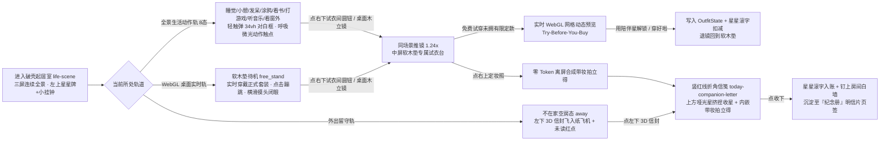

# PRD-0002：破壳起居室陪伴、专属试衣间与带妆明信片工坊（小程序 1:1 同源全景版）

- **状态**：Approved & In Implementation（`v1.1` · 选项 A 官方三屏全景版）
- **适用范围**：`living-room-dress/`（独立预览与契约样板，可无缝并入 `eggbabe-uni/` 双端主工程）
- **覆盖宠物**：玉兔（Jade Rabbit / Yutu，24 套全身装）· 锦鲤（Boon Koi，12 套全身装）
- **关联文档**：[`PRD-0001` 轻陪伴电子宠物](0001-light-companion-pet.md)、[`AGENTS.md`](../../AGENTS.md)

---

## 1. 产品背景与核心边界

### 1.1 设计初衷
借鉴《动物去哪儿》的**「单空间多状态生活感 + 外出归来明信片沉淀」**心流，深度融合 `eggbabe-miniprogram` 破壳后主场景（`pages/life-scene`）的原生 UI 质感与 `eggbabe-h5` 独有的**微距毛绒 WebGL 网格换装引擎**，打造闭环体验：
1. **100% 复刻小程序破壳房间视觉与交互**：直接采用破壳后官方三屏连续全景画卷（`2823 × 1672` 比例，含白天 `day` / 落日 `sunset` / 黑夜 `night` 三时段与玉兔、锦鲤全部 8 种居家动作全景），并 1:1 复刻左上三阶陪伴星星牌、可切换圆盘/数字小挂钟、顶中三屏圆点、`34vh` 双层场景反馈栈、左下 3D 信封/对话圆钮、右下 3D 开盖百宝箱、竖红线折角伴侣信笺及 `#FAFAF8` 纪念册画布页；
2. **同场景推镜「专门试衣间」**：点击右下「试衣间」立体圆钮或书桌上的微距原木小立镜，不切走房间，镜头平滑推近中屏书桌软木垫，支持未解锁限定装**免费上身动态试穿（Try-Before-You-Buy）**，满意再用陪伴星星解锁；
3. **纯审美换装 × 零 Token 带妆拍立得**：服装**严禁影响路线偏好、交通方式或数值属性**；偶遇剧情由主线故事引擎驱动，前端以零 Token 离屏合成直出穿戴当前正式套装的插画拍立得，嵌入竖红线折角信笺送达，收下后挂上房间墙面并存入纪念册。

### 1.2 明确不做的事（Non-Goals）
- **不做多房间俯视寻路**：只聚焦三屏连续全景的窗边卧室书桌空间（左屏木床休憩 · 中屏软木垫书桌 · 右屏大窗与圆边几），废弃四房等距迷宫寻路。
- **不做装备数值与策略捆绑**：衣服仅负责审美愉悦与纪念照外观呈现。
- **首期零 AI 生图 Token 消耗**：明信片采用前端确定性 WebGL 姿态快照与场景环境光融合，零等待、零边际成本。
- **严守仓库隔离规范**：与小程序主仓保持仓库级零侵入，通过标准 `OutfitState` 与 `PostcardPayload` JSON 协议衔接。

---

## 2. 全局用户旅程与双轨状态架构

---

## 3. 环节一：三屏连续全景空间与昼/昏/夜光影规范

### 3.1 连续三屏全景画卷（`world-scroll` × `world-track`）
- **母图基准坐标系**：`2823 × 1672`（宽高比 `1.6884:1`），由左至右自然贯通三个功能区：
  - **Screen 0（左屏 `world-panel--living`）**：原木半包床盒、云朵星星绒毯、床顶暖光小台灯、植物相框白墙；
  - **Screen 1（中屏 `world-panel--desk`）**：书桌圆形软木垫（WebGL 站立与试衣圆台核心区）、热美式咖啡杯、卷笔刀与木杆笔；
  - **Screen 2（右屏 `world-panel--decor`）**：蕾丝纱帘大窗（远眺城市绿树街景）与双层原木圆边几。
- **跨端视口映射公式（`mapPanoramaPoints`）**：
  - **手机竖屏（宽高比 `< 1.15`）**：`world-track` 宽 `300vw`、高 `100dvh`，支持丝滑横向滑动与三屏分屏吸附，顶部居中 `.screen-dots` 实时指示当前屏（`0 / 1 / 2`）；
  - **桌面横屏（宽高比 `≥ 1.15`）**：按母图原始宽高比自适应铺满舞台视口，三屏全景一览无余，零纵向裁切；
  - 所有热区、微光点、桌面道具与 WebGL 宠物锚点均以 `2823 × 1672` 母图像素声明，运行时经 `scale = max(trackW / 2823, trackH / 1672)` 实时折算，确保任意机型零错位。

### 3.2 白天 / 落日 / 黑夜三时段全景与交叉淡入
- 按本地时间自动匹配时段（`06:00–16:59` `day` · `17:00–19:29` `sunset` · `19:30–05:59` `night`）；
- 切换时段或状态全景时，先后台预加载目标 PNG（`.world-panorama-preload`），解码完成后以 `520ms ease-out` 执行旧图淡出交叉过渡（`.world-panorama-bg--previous-fading`），严禁白屏闪烁。

---

## 4. 环节二：10 态双轨生活状态机与换装物理衔接规范

### 4.1 完整状态清单与母图精确锚点（`2823 × 1672`）

| 状态 Key | 名称 | 所在屏 | 渲染轨道 | 玉兔 / 锦鲤角色锚点 `(x, y)` | 互动光点锚点 `(x, y)` | 交互与文案反馈 |
| :--- | :--- | :---: | :--- | :---: | :---: | :--- |
| `free_stand` | **桌面待机/跳跃** | `1`（中） | **WebGL 实时带妆轨** | `(1415, 1085)` | 桌面木立镜 `(1155, 955)` | 穿戴当前正式套装站在软木垫上；点头歪头眨眼、点身欢呼跳、横滑摸头闭眼、点空地连跳 |
| `sleep` | **睡觉** | `0`（左） | 全景动作轨（`nap`） | 兔 `(790, 875)` / 鲤 `(650, 860)` | 台灯 `(663, 344)` | *“我把被角压在脸下面，睡得很安静。”* 点台灯微光：*“房间暗下来，我翻了个身。”* |
| `lazy` | **小憩** | `0`（左） | 全景动作轨（`lazy`） | 兔 `(760, 870)` / 鲤 `(650, 810)` | 被角 `(570, 980)` | *“我听见窗外亮起来了，还想再缩一会儿。”* 点被角：*“被子轻轻盖好，我往里缩了缩。”* |
| `stare` | **发呆** | `1`（中） | 全景动作轨（`stare`） | 兔 `(1450, 930)` / 鲤 `(1590, 980)` | 桌角光斑 `(1450, 930)` | *“我盯着桌上的光斑，看它慢慢走过半张纸。”* |
| `drawing` | **涂涂画画** | `1`（中） | 全景动作轨（`draw`） | 兔 `(1440, 1010)` / 鲤 `(1480, 1000)` | 画纸 `(1510, 1245)` | *“我画了半张纸，还没有决定它像云还是像鱼。”* 点画纸转向并结出「短短的铅笔」遇见纪念 |
| `reading` | **看书** | `1`（中） | 全景动作轨（`read`） | 兔 `(1420, 930)` / 鲤 `(1430, 980)` | 书页 `(1415, 1055)` | *“这一页讲到月亮，我把耳朵靠近一点听。”* 点书页翻页 |
| `gaming` | **打游戏** | `1`（中） | 全景动作轨（`game`） | 兔 `(1400, 990)` / 鲤 `(1400, 990)` | 屏幕 `(1490, 1120)` | *“这一关差一点就过去了，我连耳朵都没敢动。”* |
| `music` | **听音乐** | `1`（中） | 全景动作轨（`music`） | 兔 `(1710, 985)` / 鲤 `(1780, 1000)` | 播放器 `(1590, 1050)` | *“这首歌的尾巴轻轻绕了一圈，我还不想按暂停。”* |
| `window` | **看窗外** | `2`（右） | 全景动作轨（`window`） | 兔 `(1940, 835)` / 鲤 `(1940, 830)` | 窗景 `(2200, 450)` | *“远处的云走得很慢，我想和你一起看一会儿。”* |
| `away` | **穿新衣外出** | `1`（中） | 空房留守轨 | 空房无角色 | 桌面便签 `(1385, 1345)` | 外出旅行/打工/上学中，左下信封亮起待拆来信与带妆明信片 |

### 4.2 全景动作轨与换装的物理一致性衔接（零穿帮三法则）
1. **脱衣叠放法则**：当宠物拥有正式穿戴套装（`savedSet != null`）且处于 8 种居家动作全景态时，视为在家休息暂时脱下外出服——在床顶木板 `(420, 455)`（左屏状态）或右屏双层圆边几 `(2585, 1085)`（中/右屏状态）渲染一枚**微距实拍「叠好的针织毛绒衣物包裹」透明 PNG（`prop_folded_knit.png`）**，严禁摆放带头脚的模特缩略图；轻触衣包在 `34vh` 提示：`脱下来的「套装名」叠好放在这儿啦`。
2. **唤回桌面穿衣法则**：在任意居家动作态下，点击右下「试衣间」钮、桌面立镜或双指/轻触唤回桌面，即可无缝切入空床空垫底图 + WebGL 实时带妆角色层。
3. **穿衣出门法则**：处于 `away` 外出态时，房间内的叠放衣包同步消失，传递“它把新衣服穿出门去拍照了”的真实空间逻辑。

---

## 5. 环节三：1:1 复刻小程序全局 HUD 与交互动效规范

1. **左上状态栈 `.life-status-stack`（`left: 12px`, `gap: 14px`）**：
   - **三阶可展开陪伴心情牌 `.pet-mood-tab--post-hatch`**：奶油白磨砂底 `rgba(255,253,247,.92)`，`1px solid rgba(225,229,215,.95)`，圆角 `14px`。点击在 `minimal`（哑光星 + 滚字星数 + `连续一起 X 天`）→ `summary`（展开宠物名 + `今日心情`）→ `expanded`（展开第一人称心情短句 + `内容由 AI 生成`）三阶间循环切换，伴随 `360ms` `scene-fab-bounce` 回弹；
   - **双模小挂钟 `.room-clock`**：点击在 `56×56px` 木框圆盘指针钟（`#819A54` 绿秒针实时走动）与 `88×46px` 数字电子钟间切换。
2. **顶中三屏指示点 `.screen-dots`**：`top: calc(59px + safe-top)`，未激活 `4.5px` 半透明白点，激活 `14×4.5px` 纯白胶囊。
3. **中场 `34vh` 场景反馈栈 `.scene-feedback-stack`**：
   - 角色对白 `dialogue`：`padding: 9px 13px`，右下尖角圆角 `14px 14px 14px 4px`，`rgba(255,253,247,.94)`，`#3D4930` `12px`；
   - 系统提示 `system`：`height: 32px` 胶囊，`rgba(18,21,18,.72)` 底，`#FFFFFF` `11px / 600`；支持双层前后堆叠晋升。
4. **左下情境圆钮 `.scene-context-entry`（`56×56px`）**：
   - 待拆信态：`#F4F5EC` 底 + 3D 信封 + 纸飞机飞入裁切动画 + `#D9463C` `8px` 未读红点；
   - 已读日常态：3D 玉兔 / 锦鲤对话圆标，点击与宠物打招呼或触发新来信演示。
5. **右下立体圆钮 Dock `.scene-action-dock`（`gap: 8px`）**：
   - 左钮：**专属试衣间**（`56×56px` `.scene-action-button` + 3D 针织毛衣木衣架图标 `ui_3d_fitting_wardrobe`）；
   - 右钮：**3D 百宝箱**（闭合/开盖双图层 `120ms` 交叉淡入 + `.28s cubic-bezier(.34,1.56,.64,1)` 弹出 `#FFFDF7` 双列浮层：**纪念册** · **带妆桌面** · **换伙伴** · **设置**）。
6. **右上隐藏验收工具 `.stage-tester`**：默认不渲染；仅当 URL 带 `?demo=1` 或 `2.4s` 内连点左上卡片 5 次时开启，复刻小程序 `验收工具 ⌄` → `场景（白天/落日/黑夜）` / `状态` / `角色` / `心情` 胶囊菜单。

---

## 6. 环节四：专属试衣间与 Try-Before-You-Buy 付费转化规范

1. **同场景推镜与零遮挡安全框**：
   - 进入 `fitting` 时，背景自动切至同光影空垫全景，镜头平滑推近中屏软木垫（`scale(1.24)`），确保在手机竖屏（`375×667` 起）与桌面端下，**玉兔长耳尖距顶栏 ≥ `14px`、脚底与裙摆距抽屉上沿 ≥ `12px`**。
2. **衣橱抽屉与先试后买交互**：
   - 顶栏：左圆形返回钮、中 `玉兔 | 锦鲤` 胶囊切换轨、右 `定妆照` 按钮；
   - 抽屉主体（`#FAFAF8` 画布底，圆角 `24px`）：顶部提供 `全部 / 已拥有 / 限定待解锁` 筛选与 `<companion-star>` 余额展示；中部为 4 列衣架卡片（选中描边 `2px solid #002900`）；
   - **免费试穿未拥有限定款**：带星星价格签的限定款点击即刻上身渲染完整 WebGL 呼吸、眨眼与欢呼跳动态，并在 `34vh` 弹出专属试穿台词；
   - **底部 `48px` 胶囊按钮栏（对齐 `button.wxss`）**：
     - 已拥有款：全宽 `#002900` `穿好啦`；
     - 未解锁款（星星充足）：左 `secondary-soft` `还原` + 右 `#002900` `用 ★ N 解锁并换上`（点击触发星星滚字扣减、解锁音效与庆祝动作）；
     - 未解锁款（星星不足）：左 `还原` + 右禁用态 `还差 ★ X`；
     - 未购买直接点返回：自动回滚至上一次正式穿搭并通过深色 `system` 胶囊平实提示 `已退出试穿，恢复原穿搭`。

---

## 7. 环节五：零 Token 带妆明信片 × 红线折角信笺 × 纪念册规范

1. **零 Token 离屏合成（`800 × 920` 纯净画心）**：
   - 依次叠绘：远景插画底图（`assets/shared/png/bgs/*.png`）→ 地面接触双层软阴影 → 离屏 WebGL 确定性姿态快照（读取玩家正式 `savedSet`，固定弹簧落脚点）→ `source-atop` 环境色温柔光层；**画心内部严禁绘制任何文字框**。
2. **竖红线折角信笺弹窗（`.today-companion-overlay`）**：
   - 信纸上方悬浮 `75px` `<companion-star mode="award">` 播放 `2.0s` 挤捏发光动效与 `+#FFDD79` `+N` 收星飞字；
   - 信纸采用 `#FFF9EB` 底 + 左侧浅红竖线 + 右上 `225°` 折角 `::after` + 楷体书信正文 + 内嵌 `#FFFDF8` `.companion-polaroid` 拍立得相框（下沿印地点与 `身穿 · 套装名`）；
   - 底部提供 `收下` 与 `保存相片`（一键导出含拍立得白框、穿搭小签与手记的完整高清纪念卡）。
3. **全屏画布纪念册（`keepsake-album`）**：
   - `#FAFAF8` 底 + `56px` `nav-bar` + `#E6E8E1` 分段轨（`遇见 | 明信片`）；
   - `遇见` 页签展示居家动作与外出带回的小物件卡片（如短短的铅笔、旧木纽扣、银杏叶等）；`明信片` 页签以 3 列 `132%` 比例网格展示全部带妆拍立得，点击查看详情大图与来信全文；
   - `localStorage` 仅持久化轻量 JSON 元数据，杜绝 base64 大图溢出存储配额。
